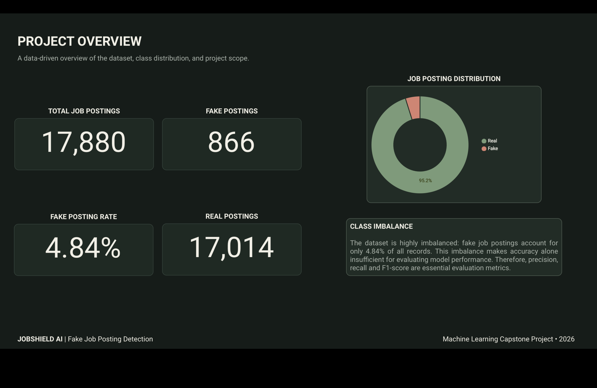
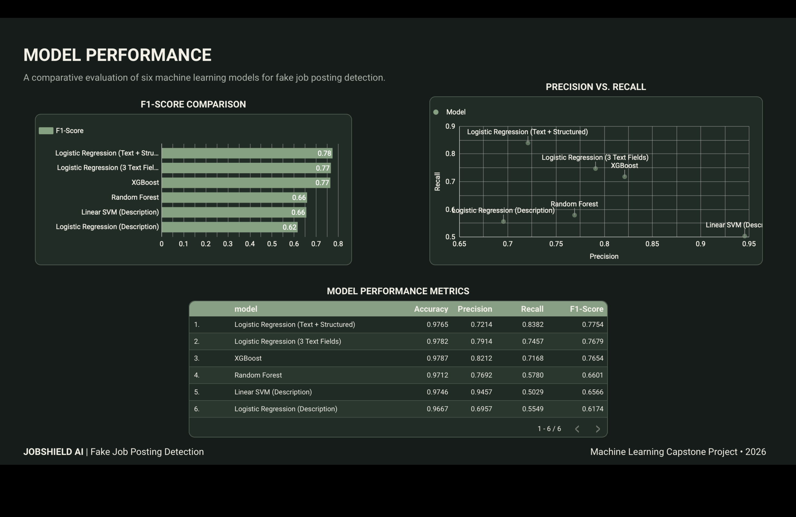
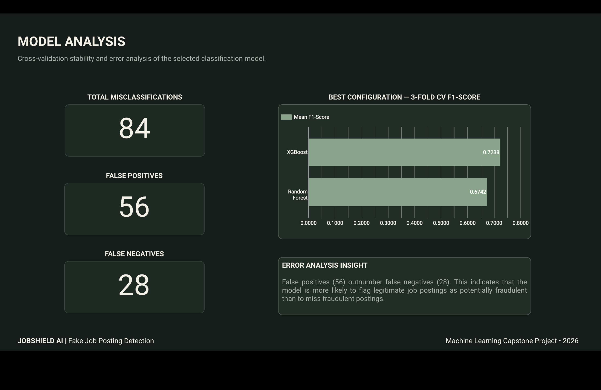

# JobShield AI

**An AI-powered machine learning project for identifying potentially fraudulent job postings.**


JobShield AI is a machine learning classification project that analyzes job posting text and structured information to estimate whether a job posting is real or potentially fraudulent.

The project combines Natural Language Processing (NLP), feature engineering, model comparison, and an interactive Streamlit application to explore how machine learning can support safer job searching.

## Project Overview

Online job platforms may contain misleading or fraudulent job advertisements. These postings can expose job seekers to financial risks, identity theft, and misuse of personal information.

The goal of JobShield AI is to investigate how machine learning can help identify suspicious job postings by analyzing textual content and available structured information.

**Research Question**

Does combining structured job posting features with textual information improve the detection of fraudulent job postings?

## Dataset

**Source:** [Real or Fake? Fake Job Posting Prediction — Kaggle](https://www.kaggle.com/datasets/shivamb/real-or-fake-fake-jobposting-prediction)

The project uses the `fake_job_postings.csv` dataset.

| Dataset information | Value |
|---|---:|
| Total postings | 17,880 |
| Real postings | 17,014 |
| Fake postings | 866 |
| Real posting rate | 95.16% |
| Fake posting rate | 4.84% |

The dataset is highly imbalanced. Therefore, accuracy alone is insufficient for evaluating model performance.

**Data access**

Download `fake_job_postings.csv` from Kaggle and place it in:

```text
data/raw/fake_job_postings.csv
```

Raw and processed data files are excluded from Git.

Please review the dataset's licensing and usage conditions on Kaggle before redistribution.

## Methodology

### 1. Data Exploration and Preparation

- Explored dataset structure, feature distributions, and missing values.
- Examined the distribution of real and fraudulent postings.
- Investigated repeated job descriptions to reduce the risk of data leakage.
- Used a stratified group splitting approach to keep identical job descriptions within the same data partition.

### 2. Feature Engineering

**Textual features**

- Job description
- Company profile
- Job requirements

Text data was transformed using TF-IDF.

**Structured features**

- Employment type
- Required experience
- Required education
- Industry
- Job function
- Telecommuting
- Company logo availability
- Screening questions

### 3. Model Development

The project compares several machine learning approaches:

- Logistic Regression
- Linear Support Vector Machine (Linear SVM)
- Random Forest
- XGBoost

The Streamlit application uses the combined Logistic Regression model, incorporating textual and structured features.

### 4. Evaluation Strategy

Because fraudulent postings represent a small proportion of the dataset, the project focuses on:

- Precision
- Recall
- F1-score
- Accuracy as a supplementary metric

F1-score is particularly useful for evaluating the balance between precision and recall in this imbalanced classification problem.

## Model Performance

The following results were obtained on the held-out test set.

| Model | Accuracy | Precision | Recall | F1-score |
|---|---:|---:|---:|---:|
| Description-only Logistic Regression | 0.9667 | 0.6957 | 0.5549 | 0.6174 |
| Description-only Linear SVM | 0.9746 | 0.9457 | 0.5029 | 0.6566 |
| Three-text-field Logistic Regression | 0.9782 | 0.7914 | 0.7457 | 0.7679 |
| Combined Logistic Regression | 0.9765 | 0.7214 | **0.8382** | **0.7754** |
| Random Forest | 0.9712 | 0.7692 | 0.5780 | 0.6601 |
| XGBoost | **0.9787** | **0.8212** | 0.7168 | 0.7654 |

**Key finding**

The combined Logistic Regression model achieved the highest F1-score (0.7754) and recall (0.8382) among the evaluated models.

This model was selected for the Streamlit application because its recall and F1-score align with the project's objective of identifying potentially fraudulent postings.

**Comparison note:** Random Forest and XGBoost used dimensionality-reduced text features (Truncated SVD), while the Logistic Regression experiments used a different text representation. Therefore, the results should not be interpreted as a perfectly controlled algorithm-only comparison.

### Cross-Validation Analysis

Random Forest and XGBoost were also evaluated using three-fold cross-validation and hyperparameter comparisons.

| Model | Best Mean CV F1-score | Standard Deviation | Folds |
|---|---:|---:|---:|
| XGBoost | 0.7238 | 0.0424 | 3 |
| Random Forest | 0.6742 | 0.0791 | 3 |

These results represent the best configurations selected for each model during the cross-validation experiments.

### Error Analysis

The selected model produced 84 misclassifications on the held-out test set:

- False Positives: 56
- False Negatives: 28

This indicates that some legitimate postings may be flagged as potentially fraudulent, while some fraudulent postings may be missed.

## Dashboard — Looker Studio

A three-page dashboard was created in Looker Studio to communicate the project findings and model evaluation results.

### Dashboard Cover


### 1. Project Overview

Provides an overview of the dataset, including total postings, class distribution, and the proportion of fraudulent postings.



### 2. Model Performance

Compares the evaluated models using F1-score, precision, recall, and accuracy.



### 3. Model Analysis

Presents cross-validation results, misclassification counts, and error analysis insights.



The dashboard's supporting CSV and Excel exports are available in the `powerbi/` directory.

## Streamlit Application

JobShield AI includes an interactive Streamlit application for analyzing job postings.

Users can enter textual information and structured job posting features to receive:

- Predicted class: Real or Fake
- Model-assigned fake-class probability score
- Visual classification results
- Independent verification guidance

The application uses the trained model stored at:

```text
models/combined_model.joblib
```

### Run Locally

**1. Clone the repository**

```bash
git clone https://github.com/laraolgun74-creator/JobShield_AI.git
cd JobShield_AI
```

**2. Create and activate a virtual environment**

macOS / Linux:

```bash
python3 -m venv .venv
source .venv/bin/activate
```

Windows:

```powershell
py -m venv .venv
.venv\Scripts\Activate.ps1
```

**3. Install dependencies**

```bash
python -m pip install --upgrade pip
pip install -r requirements.txt
```

**4. Launch the application**

```bash
streamlit run app/app.py
```

The trained model is included in the repository. The raw dataset is not included and is only needed if you want to reproduce the data preparation and model training workflow.

## Project Structure

```text
JobShield_AI/
│
├── app/
│   ├── app.py
│   └── README.md
│
├── data/
│   ├── raw/
│   └── processed/
│
├── models/
│   ├── combined_model.joblib
│   └── README.md
│
├── notebooks/
│   ├── 01_data_inspection.py
│   ├── ...
│   ├── 16_prepare_demo_examples.py
│   ├── 17_prepare_powerbi_data.py
│   ├── 18_create_powerbi_workbook.py
│   └── 19_prepare_cv_best_configs.py
│
├── powerbi/
│   ├── model_performance.csv
│   ├── cv_summary.csv
│   ├── cv_summary_best_configs.csv
│   ├── dataset_overview.csv
│   ├── class_distribution.csv
│   ├── error_summary.csv
│   ├── error_details.csv
│   └── JobShield_AI_PowerBI_Data.xlsx
│
├── reports/
│   ├── dashboard/
│   ├── figures/
│   ├── final_model_comparison.csv
│   ├── advanced_model_cv_results.csv
│   └── progress_log.md
│
├── src/
├── tests/
├── requirements.txt
└── README.md
```

## Limitations and Future Improvements

- The dataset is historical and may not represent current job market patterns.
- The model relies on the information supplied in a job posting and cannot independently verify a company or vacancy.
- Some fraudulent postings may appear legitimate based on their textual content.
- Some legitimate postings may contain features that resemble fraudulent postings.
- Model predictions are not proof of fraud.

Potential future improvements include:

- Using more recent job posting datasets.
- Incorporating company activity and posting frequency.
- Analyzing changes in employee counts.
- Combining textual information with additional real-world company signals.
- Improving generalization to current job market conditions.

JobShield AI should be treated as a decision-support prototype, not a replacement for independent verification.

Always verify the employer's official website, contact information, and application process before sharing personal or financial information.

## Tools and Technologies

- Python
- Pandas
- NumPy
- Scikit-learn
- TF-IDF
- Logistic Regression
- Linear SVM
- Random Forest
- XGBoost
- Streamlit
- Looker Studio
- Matplotlib
- Git and GitHub

## Project Status

**Completed — Data Science Capstone Project**

Developed as part of a Data Science and AI training program.
